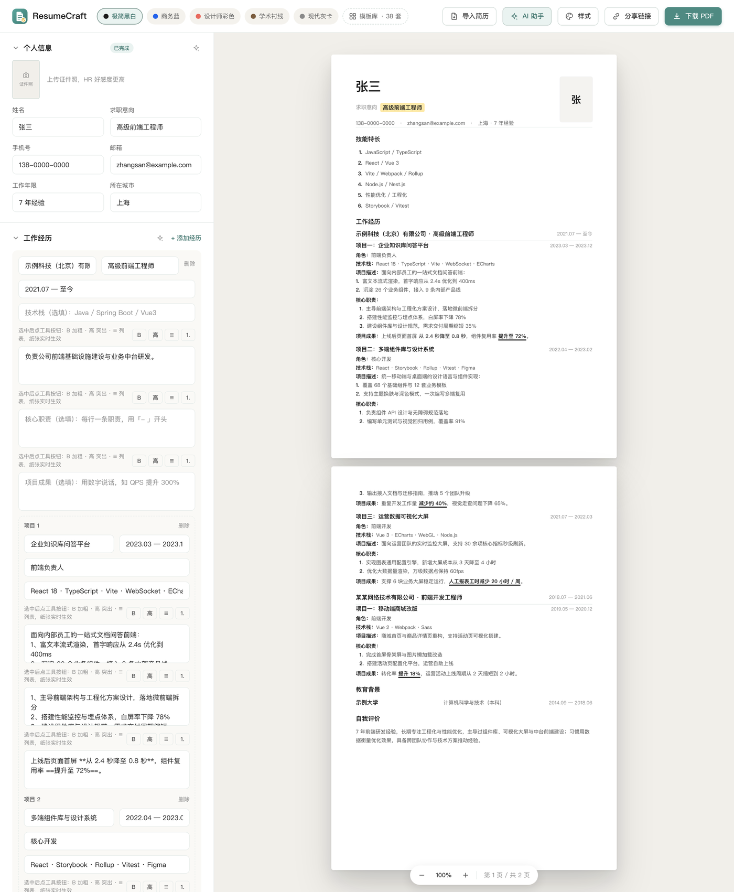
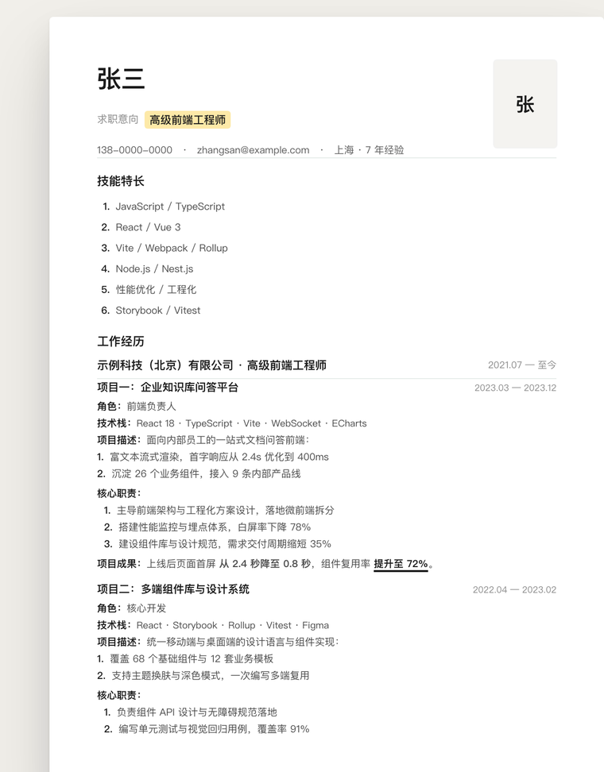

<div align="center">

# ResumeCraft · 简历工坊

**免费开源的简历制作器 —— 38 套职业模板 · AI 辅助写作 · 所见即所得 · 一键导出 A4 PDF**

不用注册、不用登录、没有后端。简历数据全程留在你自己的浏览器里。

[](LICENSE)
[](https://react.dev)
[](https://www.typescriptlang.org)
[](https://vitejs.dev)
[](https://tailwindcss.com)
[](https://github.com/yuanlaiai/resume/pulls)

</div>



## 这是什么

市面上的简历工具，要么好看的收费、免费的导出带水印，要么就是让你把姓名、手机号、身份证信息一条条填进某个公司的服务器。ResumeCraft 想解决的就是这两件事：

- **排版交给工具** —— 38 套职业模板，左侧编辑右侧实时成稿，不用跟 Word 的段落缩进搏斗
- **数据只属于你** —— 纯前端应用，所有内容存在浏览器本地，导出走系统打印，**没有任何服务器接收你的简历**

如果你正在找工作，直接 clone 下来本地跑，或者部署到自己的静态托管上，比任何在线工具都安心。

## 特性

### 编辑与预览

- **所见即所得**：左侧编辑 → 右侧 A4 纸张实时同步，字段填充时高亮脉冲提示改了哪里
- **38 套职业模板**：简约经典 / 商务正式 / 创意设计 / 深色质感 / 清新彩色，覆盖单栏、双栏、时间轴、教育前置等多种版式
- **自定义样式**：主题色换肤（9 组预设 + 取色器）、姓名艺术字（5 种）、装饰插画（12 种）
- **富文本排版**：正文支持 **加粗**、==关键字突出==（主题色下划线，打印保留）、有序 / 无序列表；工具栏一键操作，也可以手写 `**加粗**`、`==突出==` 这类标记
- **项目制经历**：支持「一家公司下挂多个项目」的简历结构 —— 每条经历可含 项目名称、角色、技术栈、项目描述、核心职责、项目成果，导入自动识别归位，编辑器逐字段可改
- **模块拖拽**：纸张上的内容模块可拖拽调整顺序
- **分区可编辑**：姓名、求职意向、电话、邮箱、城市、工作年限、教育背景、技能特长全部可改，不留死数据



### AI 助手（可选，接入 DeepSeek）

> 不配置 API Key 也能用 —— 会走内置的规则解析引擎，导入与编辑功能不受影响。

- **AI 智能导入**：PDF / Word 抽取文本后先由 AI 校对（修乱码、合并错误断行、剔除页眉页脚噪声），再结构化解析，识别率明显高于纯规则
- **主动体检**：按业界通行标准（量化成果、强动词开头、STAR 法则等）分析简历，给出最多 5 条优化建议，逐条确认应用，全部可撤销
- **对话式改进**：直接发消息改简历，可限定范围（只优化工作经历 / 自我评价……），AI 的产出自动带富文本标记
- **优雅降级**：Key 无效或请求失败时自动回退到规则引擎，不阻塞使用

### 导入与导出

- **简历导入**：本地解析 PDF / Word(.docx)（pdf.js + mammoth），自动识别姓名、联系方式、城市、工作年限、工作与项目经历（含技术栈 / 核心职责 / 项目成果）、教育背景、技能、自我评价；导入后自动排版（要点列表化 + 量化数据加粗 + 亮点突出）
- **中文解析优化**：康熙部首码位折叠、中文字间伪空格归一化、双栏表格分栏还原、序号标题剥离、项目制字段归位
- **多页分页引擎**：按区块实测高度自动分页，避免标题孤行与背景断层，长简历跨页边界干净
- **导出 PDF**：走系统打印输出 A4 纸张副本，「另存为 PDF」即得矢量文字 PDF，可被 ATS 系统正常读取
- **分享链接**：简历 + 模板 + 样式编码进 URL，对方打开即载入并可继续编辑，不经过任何第三方存储

## 快速开始

```bash
git clone https://github.com/yuanlaiai/resume.git
cd resume
npm install
npm run dev      # http://localhost:5173
```

构建生产版本：

```bash
npm run build    # 产物输出到 dist/
npm run preview  # 本地预览构建产物
```

### 配置 AI 助手（可选）

1. 在 [platform.deepseek.com](https://platform.deepseek.com) 申请 API Key
2. 二选一：
   - **环境变量**：`cp .env.example .env`，填入 `VITE_DEEPSEEK_API_KEY=sk-...`，重新构建生效
   - **浏览器内填写**：应用里点「AI 助手」→ 粘贴 Key → 保存（存 localStorage，优先级高于环境变量）

> `.env` 已被 `.gitignore` 排除，不会进仓库。环境变量是构建时注入的，部署到托管平台时需在构建环境里配置。
> Key 只在你和 DeepSeek 之间直连，项目自身不中转、不存储。

### 部署

构建产物是纯静态文件，没有服务端依赖，扔到任意静态托管即可：

```bash
npm run build
# 把 dist/ 部署到 Vercel / Netlify / Cloudflare Pages / GitHub Pages / EdgeOne Pages …
```

GitHub Pages 示例（仓库 Settings → Pages → Source 选 GitHub Actions，或本地推到 `gh-pages` 分支）。

## 测试

```bash
# 解析引擎单测：多段经历 / 混乱版式 / 装饰符号 / 序号标题 / 项目经历 / 富文本标记
node --experimental-strip-types scripts/test-parse.ts

# 导入链路端到端测试（需要本地样本文件，见脚本头部的路径说明）
node --experimental-strip-types scripts/test-import.ts
```

## 目录结构

```
src/
├── App.tsx                  # 状态管理 + 分享/打印/导入联动 + AI 助手接线
├── index.css                # Tailwind v4 + 设计令牌（CSS 变量）+ 打印样式
├── types.ts                 # 数据模型（模板 / 版式 / 富文本）
├── lib/
│   ├── parseResume.ts       # 导入解析引擎（PDF/Word 抽取 + 中文识别 + 自动排版）
│   └── deepseek.ts          # DeepSeek 客户端（解析 / 体检 / 对话改进，Key 双来源）
├── data/templates.ts        # 38 套职业模板（含示例内容）
└── components/
    ├── TopBar.tsx           # 顶部栏：模板库 / 样式 / AI 助手 / 分享 / 下载
    ├── AiPanel.tsx          # AI 助手（优化建议 + 范围对话 + Key 配置）
    ├── EditorPanel.tsx      # 编辑区（折叠面板 + 富文本工具栏 + AI 入口）
    ├── ResumePaper.tsx      # A4 纸张渲染（多版式 + 富文本 + 分页 + 拖拽）
    ├── StylePanel.tsx       # 样式面板（主题色 / 艺术字 / 插画）
    ├── PreviewPane.tsx      # 预览区（缩放 / Toast）
    ├── PaperDeco.tsx        # 装饰插画（12 种 SVG）
    ├── nameArt.tsx          # 姓名艺术字（5 种）
    └── icons.tsx            # SVG 图标
scripts/
├── test-parse.ts            # 解析引擎单测
└── test-import.ts           # PDF/Word 导入端到端测试
```

## 技术栈

| 层 | 选型 |
| --- | --- |
| 框架 | React 18 + TypeScript 5.6 |
| 构建 | Vite 5 |
| 样式 | Tailwind CSS v4（CSS 变量做设计令牌，天然支持换肤） |
| 文档解析 | pdf.js（PDF 文本抽取）、mammoth（.docx → HTML） |
| AI | DeepSeek API（可选，浏览器直连） |
| 后端 | **无** |

## 常见问题

**Q：不配置 API Key 能用吗？**
能。导入会走内置规则解析引擎，编辑、模板、导出全部不受影响，只是没有 AI 校对和体检建议。

**Q：我的简历数据会被上传吗？**
不会。项目没有后端，解析在浏览器里完成，数据存在 localStorage。分享链接是纯 URL 编码，不落任何服务器。唯一的外发请求是 AI 功能，且只在你自己配置了 Key 时发生。

**Q：导出的 PDF 能被招聘系统（ATS）解析吗？**
是矢量文字 PDF，不是图片，主流 ATS 可正常提取文字。建议导出后自己搜一下关键词验证。

**Q：为什么下载 PDF 是唤起打印窗口？**
浏览器端生成真正的 PDF 文件需要引入重型的 PDF 库（体积翻几倍），而且很难做到与预览像素级一致。走系统打印能做到「预览什么样，导出就什么样」，跨页控制也更可靠。

**Q：支持英文或其他语言吗？**
界面和解析规则目前以中文为主。简历内容填英文可以正常排版与导出，解析引擎对英文的识别相对粗糙，建议英文简历手填或用 AI 导入。

**Q：字体加载慢？**
默认引用了 Google Fonts 的 Noto Sans SC。国内网络环境下加载可能较慢或失败，此时会回退到系统字体（苹方 / 微软雅黑），不影响功能。介意的话可以把字体文件下载到 `public/` 并改成本地引用。

## Roadmap

- [ ] 英文 / 双语模板
- [ ] 导出 DOCX
- [ ] 模板贡献规范与在线预览
- [ ] 移动端编辑体验优化
- [ ] 更多 AI 能力（JD 匹配、按岗位定制）

## 贡献

欢迎 Issue 和 PR，特别欢迎：

- **新模板** —— 新增模板在 `src/data/templates.ts`，改完自测 `npm run build` 通过即可
- **解析增强** —— 遇到解析失败的简历样本，欢迎附脱敏样本提 Issue
- **i18n** —— 英文界面与英文解析规则

提交前请确保：

```bash
npm run build                        # 构建通过
node --experimental-strip-types scripts/test-parse.ts   # 解析单测全绿
```

## License

[MIT](LICENSE) © 2026 [yuanlaiai](https://github.com/yuanlaiai)

用得上就给个 ⭐️，也欢迎把它部署到自己的域名上自用。
